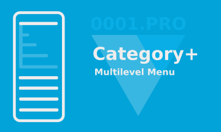
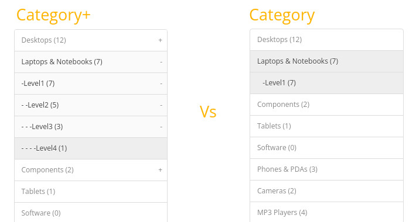

# Category Plus — Multilevel Menu for OpenCart 3.x

**Category Plus** is an archived extension for OpenCart 3.x that enhances the standard category menu and allows displaying categories with an arbitrary number of nested levels.

The extension was originally developed and distributed by **0001.pro**.

> **Archive status:** This project is preserved for historical and compatibility purposes. It is no longer actively developed or supported.

## Features

- Unlimited category nesting levels
- Multi-store support
- Several category display modes:
  - compact
  - partially expanded
  - fully expanded
- Ability to open all category levels
- Configurable number of initially opened levels
- Support for disabled categories and subcategories
- Compatible with the standard OpenCart category layout

## Screenshots

## Compatibility

The extension was released for the following OpenCart 3.x versions:

- 3.0.0.0
- 3.0.1.1
- 3.0.1.2
- 3.0.2.0
- 3.0.3.0
- 3.0.3.1
- 3.0.3.2
- 3.0.3.3
- 3.0.3.5
- 3.0.3.6
- 3.0.3.7
- 3.0.3.8
- 3.0.5.0
- 3.0.5.1

## Installation

1. Open the OpenCart administration panel.
2. Go to **Extensions → Installer**.
3. Upload the original `categoryplus-v3.x.ocmod.zip` package.
4. Open **Extensions → Extensions**.
5. Select the appropriate extension type and enable **Category Plus**.
6. Add the module to the required Category layout.

The original `.ocmod.zip` package included in this repository is preserved as the installation package and should not be modified or repacked.

## Uninstallation

The extension can be removed using the standard OpenCart extension/module management tools.

## Version history

- **2020-02-19** — Full multi-store support
- **2020-02-20** — Support for disabled categories
- **2020-04-27** — Support for disabled subcategories
- **2020-05-12** — Correct handling of commas in category names
- **2020-08-28** — OpenCart 3.0.3.6 compatibility
- **2021-01-23** — Added opening of all category levels and configurable number of opened levels
- **2021-09-16** — OpenCart 3.0.3.8 compatibility

## Historical distribution

The extension was originally published in the **0001.pro Marketplace** on **2020-02-02** and was available there as a free extension.

Historical statistics recorded by 0001.pro:

- **Downloads:** 1,774
- **Price:** Free

The extension was also independently published on the **OpenCart Marketplace** as extension **#38454**.

Historical OpenCart Marketplace statistics:

- **Downloads:** 3,393

These figures represent statistics from two separate distribution platforms and are intentionally shown separately.

## Repository contents

This repository preserves:

- the original `categoryplus-v3.x.ocmod.zip` installation package;
- the unpacked contents of the package for source-code inspection;
- original screenshots and the extension logo;
- this README with historical project information.

The original ZIP package is preserved unchanged.

## License and support

This repository is an archive of the original project. No new license is granted by the creation of this repository.

The extension is provided **as is**. Active technical support and further development are not provided.

## Author

**0001.pro**

https://0001.pro/
